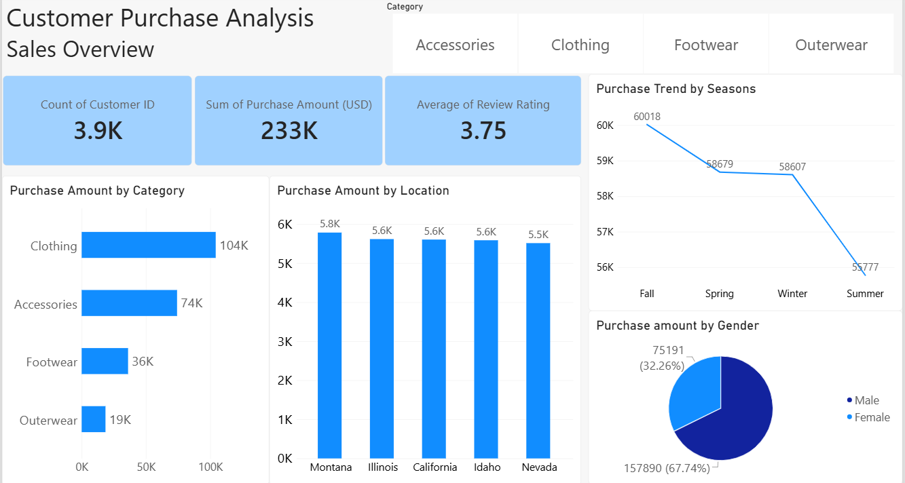
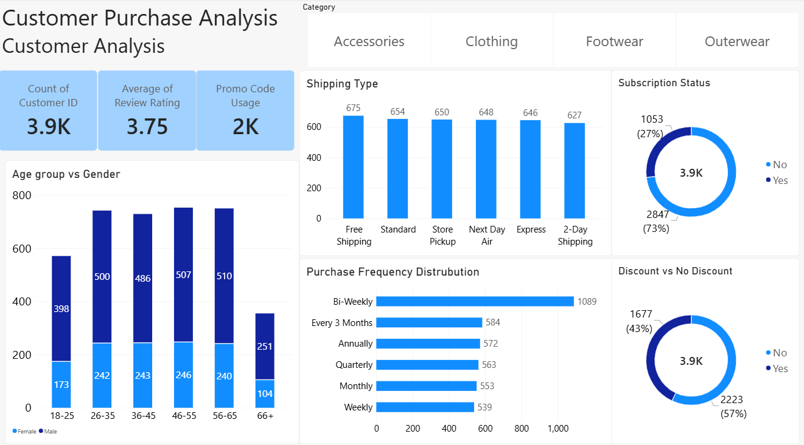

# Power BI — Customer Purchase & Sales Analysis Dashboard

## Overview
This Power BI dashboard presents customer purchase and sales analysis through interactive visualizations. It contains two pages: **Sales Overview** and **Customer Analysis**.

## Tools & Technologies
- Microsoft Power BI
- Power Query
- Data Visualization
- DAX / Measures *(include only if used in the project)*

## Dashboard Pages

### Page 1 — Sales Overview
This page provides a high-level view of customer purchase activity and sales performance.

**Key Metrics**
- Total Customers
- Total Purchase Amount
- Average Review Rating

**Visualizations**
- Purchase Amount by Category
- Purchase Amount by Location
- Purchase Trend by Season
- Purchase Amount by Gender

**Filter**
- Category slicer

### Page 2 — Customer Analysis
This page explores customer demographics and purchasing behavior.

**Key Metrics**
- Total Customers
- Average Review Rating
- Promo Code Usage

**Visualizations**
- Age Group by Gender
- Shipping Type
- Subscription Status
- Purchase Frequency Distribution
- Discount vs. No Discount

**Filter**
- Category slicer

## Dashboard Screenshots

### Sales Overview

### Customer Analysis

## Key Analysis Areas
- Category-wise purchase amount
- Location-wise sales distribution
- Seasonal purchase patterns
- Gender-wise purchase behavior
- Customer age-group analysis
- Subscription status and promo-code usage
- Shipping preferences
- Purchase frequency
- Discount usage

## Project File
[Open Power BI Dashboard](Sales%20dataset%20project.pbix)

## Outcome
The dashboard provides an interactive view of customer purchase behavior and sales performance, helping users explore patterns across categories, locations, seasons, and customer characteristics.

