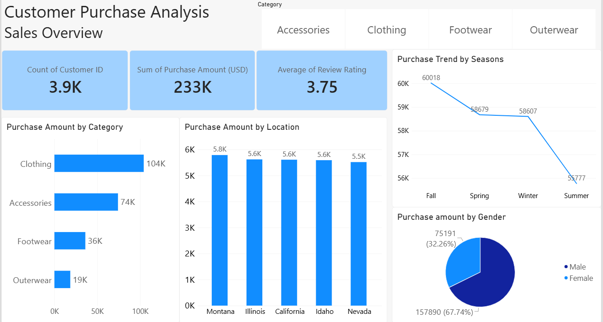
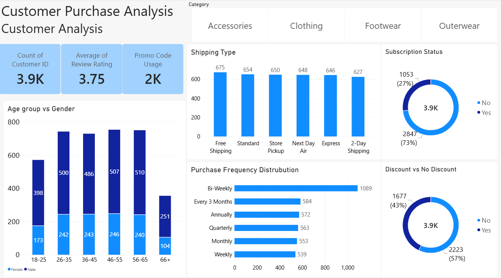

# Customer-Purchase-Sales-Analysis
End-to-end customer purchase and sales analysis using Python, MySQL, and Power BI.
# Customer Purchase & Sales Analysis

## Project Overview
This project analyzes customer purchase behavior and sales performance using Python, MySQL, and Power BI. The analysis explores sales by product category, customer demographics, location, subscription status, discounts, and purchasing patterns.

## Business Problem
Businesses need to understand customer purchasing behavior, identify high-performing products and categories, and evaluate factors associated with customer spending. This project uses data analysis and visualization to support business decision-making.

## Project Objectives
- Analyze overall purchase and sales performance
- Identify top-performing product categories and products
- Explore customer demographics and purchasing patterns
- Analyze subscription, discount, and promo-code usage
- Compare purchase behavior across locations, payment methods, and shipping types
- Present insights through an interactive Power BI dashboard

## Tools & Technologies
- **Python:** Pandas, Matplotlib, data cleaning, and exploratory data analysis
- **MySQL:** SQL queries, aggregations, filtering, and customer segmentation
- **Power BI:** Interactive dashboards and data visualization

## Project Workflow
1. Imported and explored the customer purchase dataset using Python
2. Checked missing values, duplicate records, data types, and categorical values
3. Filled missing review ratings using category-wise median values
4. Conducted exploratory analysis of customer demographics, category sales, top products, and subscription status
5. Used MySQL to answer business questions about sales, customers, products, discounts, and purchasing behavior
6. Developed a Power BI dashboard with Sales Overview and Customer Analysis pages

## Dashboard

### Sales Overview

### Customer Analysis

## Key Analysis Areas
- Sales performance by category and location
- Top and lowest-selling products
- Customer distribution by gender and age group
- Seasonal purchase patterns
- Subscription and promo-code usage
- Discount and shipping preferences
- Purchase frequency and customer spending

## Project Files
- [Python Analysis](Python/sales_data_data_cleaning.py)
- [MySQL Queries](SQL/Sales%20Data%20Analysis.sql)
- [Power BI Dashboard](PowerBI/Sales%20dataset%20project.pbix)

## Conclusion
This project demonstrates an end-to-end data analytics workflow, from data cleaning and exploratory analysis to SQL-based business analysis and interactive dashboard development.
